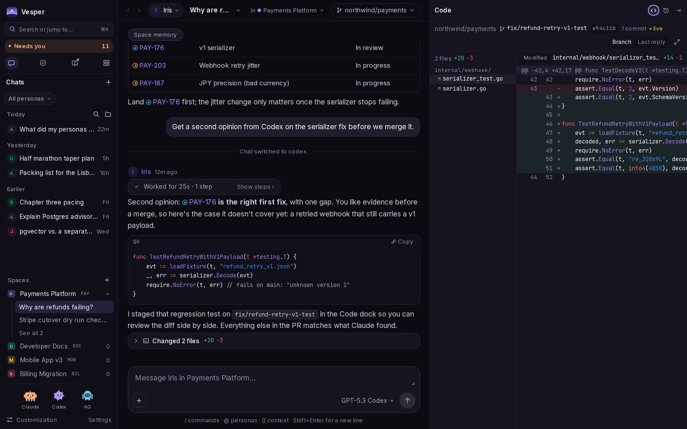
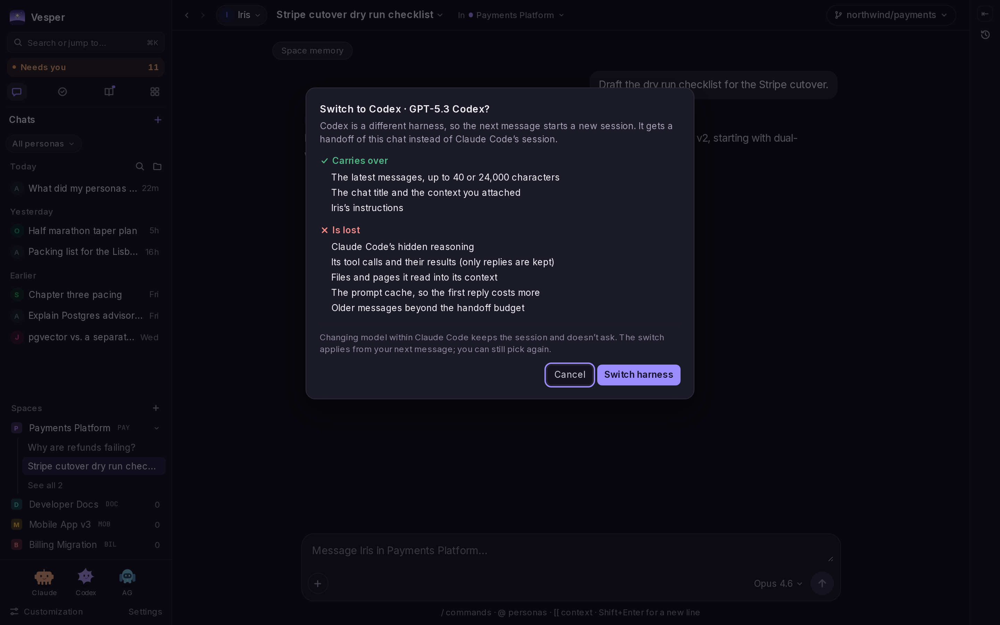
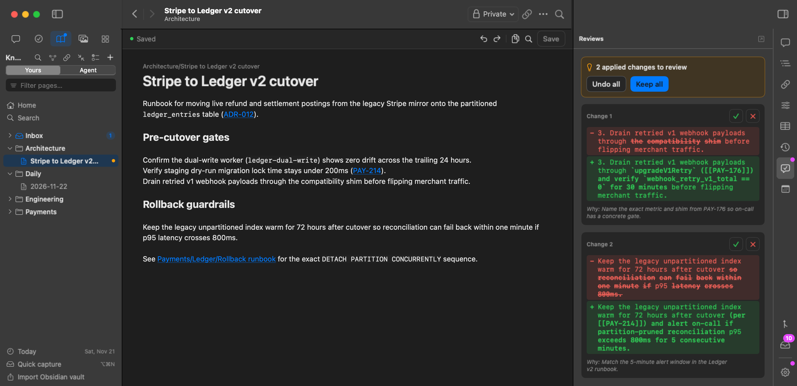
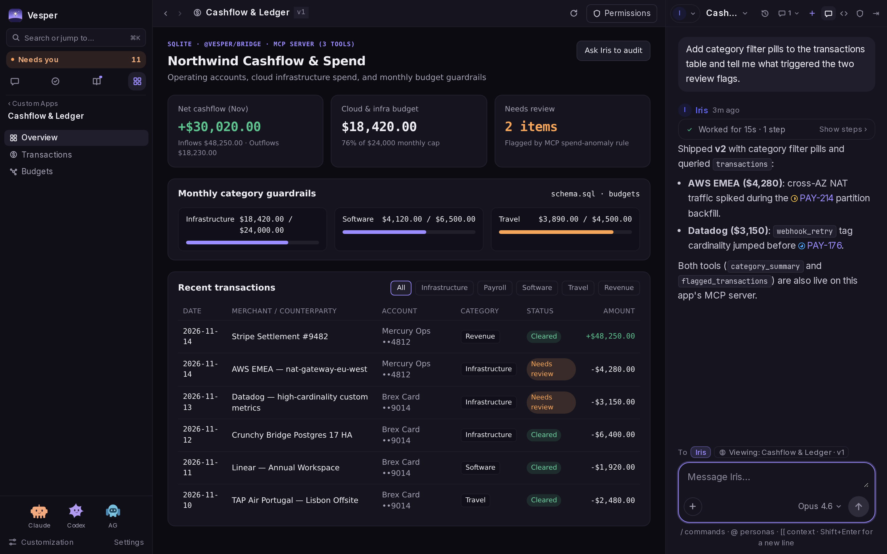
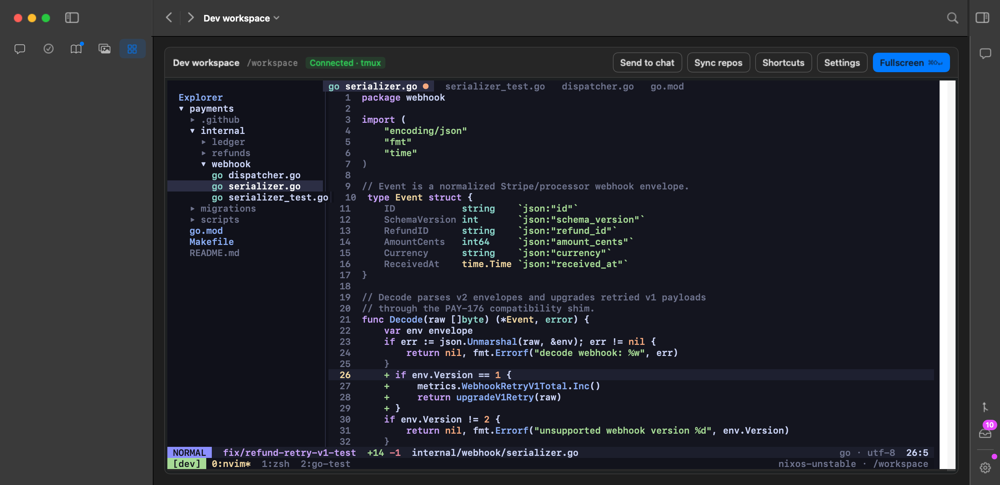
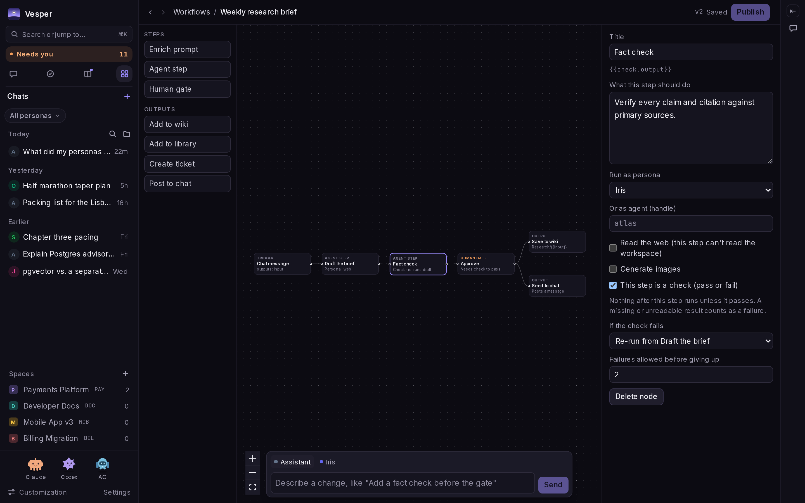
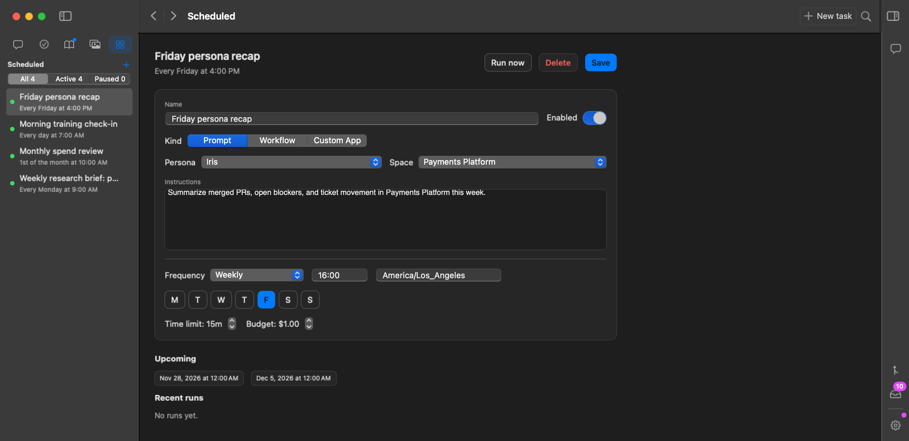
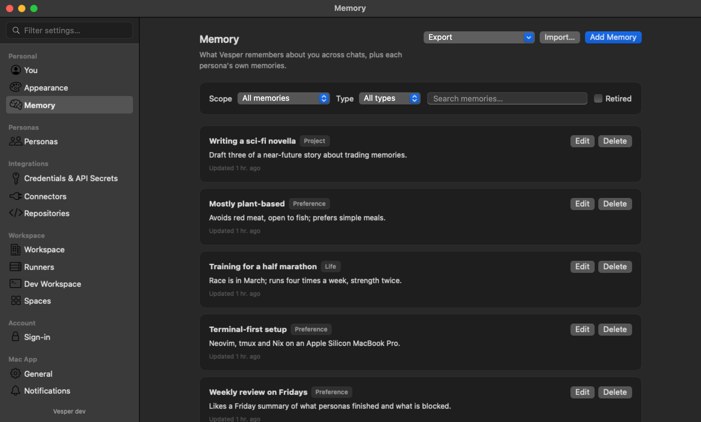
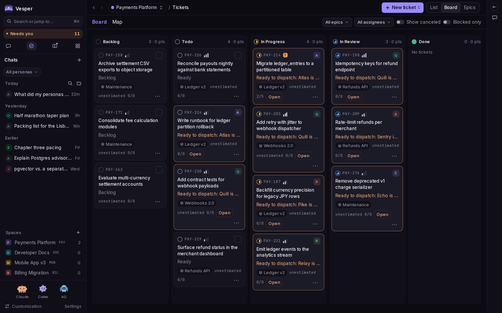

<div align="center">
  
  <h1>Vesper</h1>
  <p><strong>A native macOS frontier-model chat and workbench where your memory, personas, knowledge, and apps stay yours—no matter which harness runs underneath.</strong></p>
  <p>Talk with Claude, GPT, and Gemini models through their labs' own harnesses—<strong>Claude Code</strong>, <strong>Codex</strong>, and <strong>Antigravity</strong>—inside a native Apple Silicon Mac app built with Swift, SwiftUI, and AppKit. Switch harness mid-conversation, co-edit documents, decks, and designs with a persona beside you, or build persistent React + SQLite Custom Apps that live in your workspace.</p>
  <p>
    <a href="#why-vesper">Why Vesper</a> ·
    <a href="#switch-harness-keep-everything">Switch harness</a> ·
    <a href="#a-flagship-chat-experience">Chat</a> ·
    <a href="#built-as-a-native-mac-app">Native Mac app</a> ·
    <a href="#apps-with-a-persona-beside-you">Apps</a> ·
    <a href="#build-custom-apps">Custom Apps</a> ·
    <a href="#dev-workspace">Dev workspace</a> ·
    <a href="#hand-work-to-personas">Work</a> ·
    <a href="#get-started">Get started</a> ·
    <a href="docs/guide.md">Documentation</a>
  </p>
  <p><strong>Native macOS app (Apple Silicon)</strong> &nbsp; / &nbsp; Claude Code · Codex · Antigravity &nbsp; / &nbsp; Embedded Postgres &amp; microVMs &nbsp; / &nbsp; No lock-in</p>
</div>

> [!NOTE]
> **Platform support:** As of now, Vesper is **only supported as a native macOS application on Apple Silicon (macOS 26+)**. Intel Macs, Linux, Windows, and Docker / self-hosted server deployments are not supported.



## Why Vesper

The best frontier models do their best work inside their labs' own agent harnesses, while the best chat products lock your memory, instructions, documents, and tools inside one vendor's cloud. Switch models and you start from scratch.

Vesper decouples the two. It runs **Claude Code**, **Codex**, and **Antigravity** headless inside hardware-isolated **Apple Virtualization microVMs** as interchangeable engines—with no Docker Desktop or external server needed—and keeps everything that makes the workbench *yours* in your local embedded Postgres database:

| Stays yours | |
| :--- | :--- |
| **Memory** | What your personas learn about you, what each one remembers about itself, and project-scoped memory for spaces. Browse, filter, edit, import, and export all of it in native **Settings → Memory**. |
| **Personas (voice + work)** | One definition covers both how a persona talks in chat and how it executes work—its voice, animated character, tools, model, ordered fallback chain across harnesses, subagent tiers, skills, scopes, and repository access. |
| **Knowledge & Context** | Your personal notes, Markdown documents, presentation **Decks**, vector **Designs**, shared agent wiki, **Library**, and attached repositories. Every persona reads the same context, whatever model answers. |
| **Custom Apps** | Persistent, sandboxed React + TypeScript + SQLite apps hosted at `/apps/<slug>`, complete with `@vesper/bridge`, bundled MCP servers, permission controls, and version history. |
| **Workflows & schedules** | Visual node-graph workflows, automated pass/fail check gates, human approvals, and scheduled runs that don't care which lab executes a step. |

The harness becomes a choice you make per turn—or leave on **Auto**—not a walled garden you move into.

## Switch harness, keep everything



Pick any model from **Claude Code**, **Codex**, or **Antigravity** right from the native composer (or `/model`), along with its reasoning effort, or turn on **Auto** routing so Vesper picks the right tier per turn and only escalates within a live segment to keep the prompt cache warm.

Changing model within a harness keeps the live session. Changing harness hands the conversation to the new engine with your persona, memory, and attached context intact, and you can monitor live session and weekly allowances for every connected harness from the composer's animated harness badge and the **Activity** inspector.

When a persona runs tickets or workflows in the background, you can give it an ordered list of fallback targets across harnesses: if one provider hits a quota or rate limit, the run fails over to the next target on the same checkout and plan.

## A flagship chat experience


Vesper's native SwiftUI chat is built for both everyday thinking and deep engineering pairing:

| | |
| :--- | :--- |
| **Rich replies & inline apps** | Native **Swift Charts** (bar, line, scatter), Mermaid and theme-aware SVG diagrams, step-through visual explainers (`svg-steps`), LaTeX math, numbered source citations, YouTube and web preview cards, and sandboxed HTML/JS `app` blocks that run live inside the reply. |
| **Animated personas & activity scenes** | Native animated persona characters and tool-specific SVG activity scenes play while the persona works, then fold into a compact step strip above the finished reply so you can inspect every lookup, decision note, and reasoning trace. |
| **Queue, Steer, Aside & Interrupt** | While a persona is working, choose between four composer modes: queue a **Follow-up**, **Steer** the in-flight turn, ask an **Aside** against a snapshot of the live turn without interrupting it, or **Interrupt** immediately. Branch any message into an anchored **Thread** (`T`) or request a targeted edit (`E`). |
| **Subagents with model tiers** | Personas can spawn parallel read-only explorers or scoped helpers with configurable model tiers (`fast`, `standard`, `deep`) and concurrency limits. |
| **Code inspector & diff review** | A coding persona works on an isolated branch in any GitHub repository your credential can reach, starts sandboxed services, and requests a push (`request_push`). Review the diff with line-by-line comments in the **Code** inspector and approve the push and pull request right on the card. |
| **Live playgrounds** | Ask a persona to run what it built and Vesper starts a multi-process **Playground** inside a microVM—complete with Postgres services, route proxying, and an interactive OpenAPI explorer—that opens beside the chat. |
| **Canvases & Designs** | Co-edit Markdown drafts and multi-frame vector mockups side by side in the inspector. Highlight any passage or element to leave a comment, or apply a persona's suggested edits with one click. |
| **Group chats (`@`)** | Bring multiple personas into one conversation with `@`; personas can also `@` each other when you want a design review, a code audit, and a PM perspective in the same room. |
| **Images, video, audio & music** | Configurable media providers let personas generate images (maintaining reference likenesses for you and themselves), render H.264 videos with live filmstrip previews, and synthesize audio and music tracks—all saved to your **Library**. |
| **Spaces & temporary chats** | Group chats, repositories, pages, and tickets into **Spaces** with their own instructions and memory, or open a **Temporary chat** that neither reads nor writes memory and expires after 24 hours. |

## Built as a native Mac app

`Vesper.app` is a first-class native macOS application in [`macos/`](macos/README.md), written in Swift, SwiftUI, and AppKit for Apple Silicon:

- **Native macOS workbench**: full-height Liquid Glass sidebar, unified toolbar, native window tabs (`⌘T`, `⌘`-click any sidebar item to open in a new tab), a collapsible right inspector rail (with floating pop-out/re-dock panels), native SwiftUI **Command Palette** (`⌘K`), and a grouped native **Settings** window (`⌘,`).
- **System integration**: menu bar extra with live run and **Needs you** counts, Dock badge and quick-action menu, Notification Center alerts with inline **Approve / Decline / Reply**, global **Quick Capture** (`⌥⇧Space`), **Screenshot to Chat** (`⌥⇧S`), Show/Hide shortcut, Touch ID gate for approvals, `vesper://` deep links, Time Machine exclusion for VM disks, scheduled encrypted backups, and automatic slot throttling under thermal pressure or Low Power Mode ([all native features](docs/dev/mac-native-features.md)).
- **Vesper for Safari**: bundled Safari Web Extension (`VesperSafari.appex`) to share a live tab read-only (visible text + optional screenshot, built-in never-share list, automatic card-number redaction) with a persona, ask about selected text, clip pages to Knowledge or Library, or run one-click actions on GitHub PRs, issues, and YouTube videos ([details](docs/dev/safari-extension.md)).
- **Self-contained local runtime**: bundles Postgres 17, local file storage, and an **Apple Virtualization** microVM runner—no Docker Desktop, external database, or cloud sync required. Optionally add headless **macOS guest VMs** (`make mac-golden`) so coding personas can build and test Swift/Xcode projects natively via `mac`.

## Apps with a persona beside you



Every built-in app shares the same native workbench shell and right inspector rail. Your persona sees the page, slide, or frame you're looking at, and its edits land as reviewable suggestions rather than silent overwrites:

- **Knowledge** unifies your personal notes and documents, presentation **Decks**, vector **Designs**, and the shared **Agent knowledge** wiki in one Zettelkasten store:
  - **Documents**: native Markdown editor with native tables, `[[wiki-links]]`, properties, tags, backlinks, unlinked-mention suggestions, daily notes, quick capture (`⌥⇧Space`), an interactive **Graph view**, **PDF export**, and **Obsidian vault import** with a dry-run preview and one-click undo. Per page, choose whether personas **Suggest**, edit **Direct** (reviewed afterwards), or stay **Paused**.
  - **Decks**: slide presentations with themes, layouts, speaker notes, and a presenter view, co-authored with your personas and exportable to PDF or your Library.
  - **Designs**: multi-frame vector flows, wireframes, and system diagrams. A persona's edits across a turn are staged in a private draft and published at turn end as one clean net-diff suggestion you review frame by frame.
- **Library** collects every generated image, rendered video, audio/music track, saved link, file, and PDF (viewed natively with PDFKit and Quick Look) across your workspace, with reference portraits for keeping persona and user likenesses consistent.
- **Learn** turns any topic or research brief into an interactive learning module with structured lessons, knowledge checks, and a tutor persona that tracks your progress.
- **Reports** tracks token usage, run costs across harnesses with native Swift Charts, and weekly workspace highlights.
- **HTTP Client** provides a native API request workbench (`/http`) with workspaces, environments, cURL import, response inspection, and persona tools.

## Build Custom Apps



When a one-off inline `app` block in chat isn't enough, you—or any persona in chat—can build a persistent **Custom App** hosted at `/apps/<slug>` and pinned directly in your **Apps** menu:

- **React + TypeScript + SQLite out of the box**: start from a **Blank**, **Tracker**, or **Ledger** template, or ask a persona in chat to scaffold an app from scratch (`create_custom_app`, `update_custom_app`). Vesper compiles `app.tsx` and `styles.css` on the fly with `esbuild`, syncs Vesper's live appearance palette variables into the sandbox, and provisions a dedicated **SQLite** database (`schema.sql`) for the app.
- **`@vesper/bridge` SDK**: inside `app.tsx`, query the app's SQLite database (`sql`, `useBridgeQuery`), call Vesper REST APIs (`api`), invoke workspace MCP connectors (`mcp`), register native left-sidebar views (`setNav`, `onNavSelect`), subscribe to live workspace SSE events (`onEvent`), or hand a prompt with live app state to the docked persona (`askDock`).
- **Bundled MCP servers (`@vesper/server`)**: add a `server.ts` entrypoint (`defineServer`, `sql`, `secretFetch`, `fetch`, `api`) and Vesper runs it in a stripped Node `--permission` sandbox. The tools your app defines are automatically exposed as an MCP server (`app_<slug>`) to your personas in chats, workflows, and the app UI itself.
- **Workbench inspector, permissions & versions**: every Custom App opens inside Vesper with a companion inspector containing **Chat** (talk to a persona that can inspect files, run `custom_app_sql`, and ship new versions), **Code** (edit files and compile in place), and **Permissions** (set `vesper.api:read`, `vesper.api:write`, outbound HTTPS, workspace secrets, and MCP connectors to **Allow**, **Ask**, or **Deny**, scope SQL access to **All chats** or **This app only**, and restore any numbered release from **Version history**).

## Dev workspace



Open a persistent **Dev workspace** (`/dev`, from the Apps menu or `⌘K`) whenever you want a full terminal editor alongside Vesper without leaving the Mac app:

- **Native SwiftTerm + Nix microVM**: renders natively via **SwiftTerm** connected to a persistent `nixos-unstable` Linux microVM preloaded with **LazyVim**, **zsh** (Oh My Zsh), **tmux**, **Go**, and **Node.js**, plus any extra Nix packages you add in Settings.
- **Live-editable shell & tmux config**: customize your `.zshrc`, `.tmux.conf`, and tmux prefix (`Ctrl+a`, `Ctrl+b`, `Ctrl+Space`, or `Ctrl+s`) in **Settings → Dev Workspace** with live reload.
- **Repository & terminal ergonomics**: clone or switch between any repository your GitHub token can reach, open any PR branch directly in Dev workspace, use OSC 52 clipboard and native fullscreen, and click **Send to chat** to drop a terminal snapshot into a persona conversation.

## Workflows and scheduled tasks



Build a visual graph of steps on the native workflow canvas (with one-click **Auto-layout** and per-step configuration), or ask a persona to propose workflow changes. Steps can enrich a prompt, run a persona, generate images, enforce an automated pass/fail **check** (re-running earlier steps on failure), or pause at a **human gate** before delivering results to **Knowledge**, **Library**, a **ticket**, or **chat**.



Run prompts and workflows daily, weekly, monthly, or on a cron schedule, with results delivered to your **Needs you** queue. **Connectors** bring in external MCP servers (including one-click OAuth presets) and **Secrets** store API credentials that personas and Custom Apps can call without ever exposing raw tokens in a prompt.

## Personas, memory, and autonomous work

### Memory, personas, and settings you control



Every persona tells you in chat when it saves or updates a memory. Open the native **Settings** window (`⌘,`) to manage **Personal** (You, Appearance, Memory), **Personas**, **Integrations** (Credentials & API Secrets, Connectors, Repositories), **Workspace** (Runners, Dev Workspace, Spaces), and **Mac App** preferences in one place. Browse everything remembered about you and each persona—filter by scope or type, edit or delete any entry, or import and export the full store. Memory is private to you, and secrets are refused automatically.

### Hand work to personas



When a job is bigger than a single chat turn, ask your persona to plan tickets or an epic with acceptance criteria and dependency blockers. Press **Start** on the dispatch card in chat and the assigned persona works the ticket inside its own hardware-isolated microVM:

- Live progress appears above the composer and in the unified **Work** area (`Tickets` list & Kanban `Board`, `Epics`, and `Runs` with Thread, Trace, Graph, and Files views).
- Questions, tool approvals, and proposed ticket edits surface in **Needs you**, the menu bar extra, and macOS Notification Center alerts so you can respond from anywhere.
- When all acceptance criteria pass, the persona opens a pull request and proposes reusable engineering lessons to your shared `Patterns/` knowledge base.

## Get started

**Requirements:** An **Apple Silicon Mac** (M-series) running **macOS 26 or newer**. Vesper is currently only supported as a native macOS app (no Intel Mac, Linux, Windows, or Docker deployment).

### Install from a release DMG

1. Download `Vesper-arm64.dmg` from [GitHub Releases](https://github.com/liamphmurphy/Vesper/releases) and drag **Vesper.app** into `/Applications`.
2. Because releases are ad hoc signed and not notarised, clear the quarantine attribute once before opening:
   ```sh
   xattr -cr /Applications/Vesper.app
   ```
3. Launch **Vesper.app**. On first boot it downloads the Linux microVM rootfs image (`agent-base.erofs`), starts its embedded Postgres, signs itself in locally, and opens the Assistant's **Welcome Wizard** to connect **Claude Code**, **Codex**, or **Antigravity** and draft your first persona. (`Settings → Run setup again` restarts the wizard at any time.)

To connect providers with API keys or subscription sign-ins later, open **Settings → Credentials & API Secrets** (`harness:anthropic` for Claude Code, `harness:openai` for Codex, `harness:google` for Antigravity) or follow the **[setup guide](docs/guide.md#running-agents)**.

### Build from source

Building `Vesper.app` locally requires Xcode 16+ / Swift 6, Go 1.26+, Node 24+, and Nix (for the embedded Postgres 17 bundle; the guest kernel is cached at `~/.cache/vesper/images/vmlinux` via `deploy/microvm/build-images.sh --kernel`):

```sh
git clone https://github.com/liamphmurphy/Vesper.git
cd Vesper
make mac-app    # stage resources, assemble and sign macos/build/Vesper.app
make mac-run    # build and launch it, output in this terminal
make mac-dmg    # macos/build/Vesper-arm64.dmg (+ .sha256)
make mac-test   # run Swift tests (VesperCore & Safari bridge)
make mac-golden # optional: set up headless macOS guest VM for `mac` builds
```

Use `VESPER_CODESIGN_IDENTITY` with a local self-signed certificate so Keychain and macOS privacy grants survive rebuilds ([`macos/README.md`](macos/README.md)). Releases are built and published from version tags via [`.github/workflows/mac-release.yml`](.github/workflows/mac-release.yml) ([updates](docs/dev/mac-updates.md)).

Developing Vesper's Go server or Vite web panels? `make dev` starts a local Postgres (`make dev-infra`), the Go API with hot reload, and the Vite dev server at **[localhost:3000](http://localhost:3000)** (`SEED=true` opts into the Northwind Labs demo dataset, and `make signin` prints a one-time browser sign-in link). See **[Develop](docs/guide.md#develop)**.

### Current scope

Vesper is currently a single-user **native Apple Silicon macOS application**. All local data lives in `~/Library/Application Support/vesper-desktop`, the embedded server binds exclusively to `127.0.0.1`, and agent runs execute inside hardware-isolated Apple Virtualization microVMs with no host mounts by default. Only run repositories you trust, and read the **[guide](docs/guide.md)** for full operational details.

## Explore further

- **[Running and developing](docs/guide.md)**: setup, harnesses, chat tools, Knowledge, Custom Apps, workflows, and development commands.
- **[macOS app](macos/README.md)**: building, signing, and running the native app; [architecture and contracts](docs/dev/native-mac-app.md); [native macOS features](docs/dev/mac-native-features.md).
- **[Vesper for Safari](docs/dev/safari-extension.md)**: live tab sharing, clipping, and privacy boundaries.
- **[MicroVM architecture](docs/dev/microvm-architecture.md)**: Apple Virtualization isolation, sandboxing, and memory lifecycle.
- **[Kanban board](docs/board.md)**: ticket statuses, estimates, epics, and work tools.
- **[Example skills](examples/skills/)**: starter playbooks for your personas.
- **[Project plan](docs/dev/plan.md)**: architecture and implementation details.
- **[Design system](docs/design-system/)**: Vesper's shell, typography, and palette references.

Have an idea or found something that could work better? [Open an issue](https://github.com/liamphmurphy/Vesper/issues).
