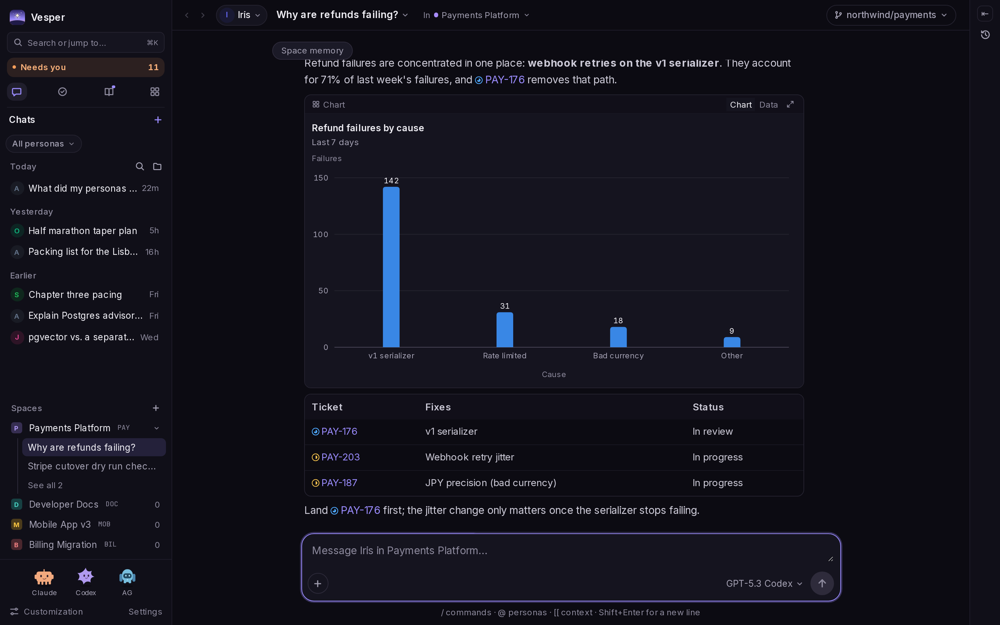
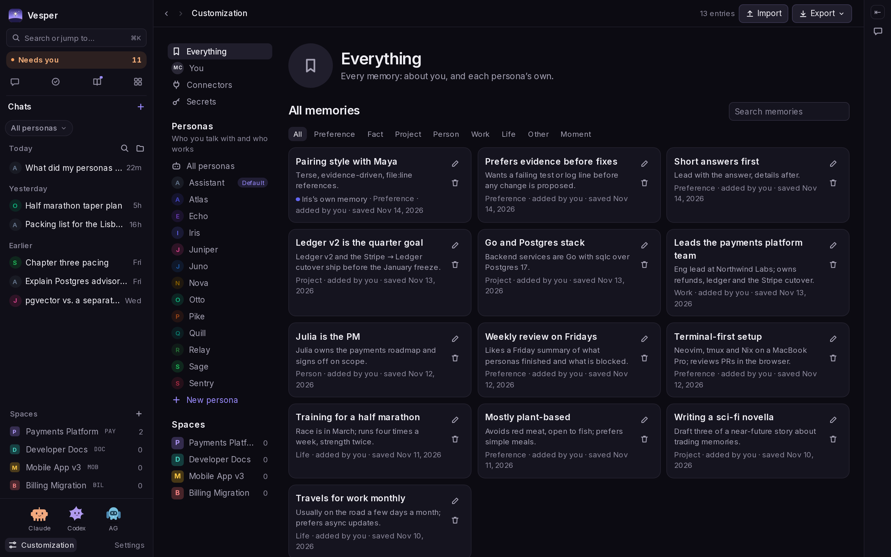

<div align="center">
  
  <h1>Vesper</h1>
  <p><strong>A frontier-model chat and workbench where your memory, personas, knowledge, and apps stay yours—no matter which harness runs underneath.</strong></p>
  <p>Talk with Claude, GPT, and Gemini models through their labs' own harnesses—Claude Code, Codex, and Antigravity—in a self-hosted workbench. Switch harness mid-conversation, co-edit documents, decks, and designs with a persona beside you, or build full React + SQLite Custom Apps that live in your workspace.</p>
  <p>
    <a href="#why-vesper">Why Vesper</a> ·
    <a href="#switch-harness-keep-everything">Switch harness</a> ·
    <a href="#a-flagship-chat-experience">Chat</a> ·
    <a href="#apps-with-a-persona-beside-you">Apps</a> ·
    <a href="#build-custom-apps">Custom Apps</a> ·
    <a href="#hand-work-to-personas">Work</a> ·
    <a href="#get-started">Get started</a> ·
    <a href="docs/guide.md">Documentation</a>
  </p>
  <p><strong>Self-hosted</strong> &nbsp; / &nbsp; Claude Code · Codex · Antigravity &nbsp; / &nbsp; Your memory, your Postgres &nbsp; / &nbsp; No lock-in</p>
</div>


## Why Vesper

The best frontier models do their best work inside their labs' own agent harnesses, while the best chat products lock your memory, instructions, documents, and tools inside one vendor's cloud. Switch models and you start from scratch.

Vesper decouples the two. It runs **Claude Code**, **Codex**, and **Antigravity** headless in hardened containers as interchangeable engines, and keeps everything that makes the workbench *yours* in your own database:

| Stays yours | |
| :--- | :--- |
| **Memory** | What your personas learn about you, what each one remembers about itself, and project-scoped memory for spaces. Browse, filter, edit, import, and export all of it. |
| **Personas (voice + work)** | One definition covers both how a persona talks in chat and how it executes work—its voice, tools, model, ordered fallback chain across harnesses, skills, scopes, and repository access. |
| **Knowledge & Context** | Your personal notes, documents, slide **Decks**, Figma-style **Designs**, shared agent wiki, **Library**, and attached repositories. Every persona reads the same context, whatever model answers. |
| **Custom Apps** | Persistent, sandboxed React + TypeScript + SQLite apps hosted at `/apps/<slug>`, complete with `@vesper/bridge`, bundled MCP servers, permission controls, and version history. |
| **Workflows & schedules** | Multi-step visual workflows, automated check gates, human approvals, and scheduled runs that don't care which lab executes a step. |

The harness becomes a choice you make per turn—or leave on **Auto**—not a walled garden you move into.

## Switch harness, keep everything


Pick any model from **Claude Code**, **Codex**, or **Antigravity** right from the composer, along with its reasoning effort, or turn on **Auto** routing so Vesper picks the right tier per turn and only escalates within a live segment to keep the prompt cache warm.

Changing model within a harness keeps the live session. Changing harness hands the conversation to the new engine with your persona, memory, and attached context intact, and tells you up front what doesn't cross the boundary (the old harness's hidden reasoning, raw tool calls, and prompt cache).

When a persona runs tickets or workflows in the background, you can give it an ordered list of fallback targets across harnesses: if one provider hits a quota or rate limit, the run fails over to the next target on the same checkout and plan.

## A flagship chat experience



Vesper's chat is built for both everyday thinking and deep engineering pairing:

| | |
| :--- | :--- |
| **Rich replies & inline apps** | Interactive bar/line/scatter charts, Mermaid and theme-aware SVG diagrams, step-through visual explainers (`svg-steps`), LaTeX math, numbered source citations, YouTube and web preview cards, and sandboxed HTML/JS `app` blocks that run live inside the reply. |
| **Live activity scenes & turn steps** | Every tool call renders its own animated SVG scene while the persona works, then folds into a compact step strip above the finished reply so you can inspect every lookup, decision note, and reasoning trace. |
| **Follow-ups, asides & threads** | While a persona is working, press Enter to queue a **Follow-up**, send an **Aside** to ask a quick side question against a snapshot of the live turn without interrupting it, or **Interrupt** immediately. Branch any message into an anchored **Thread** (`T`) or select a passage to ask for a targeted edit (`E`). |
| **Code dock & diff review** | A coding persona works on an isolated branch in any GitHub repository your credential can reach, starts sandboxed services, and requests a push (`request_push`). Review the diff with line-by-line comments in the **Code** dock or fullscreen branch file tree, and approve the push and pull request right on the card. |
| **Live playgrounds** | Ask a persona to run what it built and Vesper starts a multi-process **Playground** from the checkout—complete with Postgres/S3 services, route proxying, and an interactive OpenAPI explorer—that opens beside the chat. |
| **Canvases** | Co-edit Markdown drafts and vector mockups side by side with the conversation. Highlight any passage or element to leave a comment, or apply a persona's suggested edits with one click. |
| **Group chats (`@`)** | Bring multiple personas into one conversation with `@`; personas can also `@` each other when you want a design review, a code audit, and a PM perspective in the same room. |
| **Images, video & audio** | Personas can generate images (maintaining reference likenesses for you and themselves), render H.264 videos with live filmstrip previews, and synthesize audio tracks with waveforms—all saved to your **Library**. |
| **Spaces & temporary chats** | Group chats, repositories, pages, and tickets into **Spaces** with their own instructions and memory, or open a **Temporary chat** that neither reads nor writes memory and expires after 24 hours. |

## Apps with a persona beside you


Every built-in app shares the same workbench shell and a docked persona conversation on the right. The persona sees the page, slide, or frame you're looking at, and its edits land as reviewable suggestions rather than silent overwrites:

- **Knowledge** unifies your personal notes and documents, presentation **Decks**, Figma-style **Designs**, and the shared **Agent knowledge** wiki in one Zettelkasten store:
  - **Documents**: rich Markdown with `[[wiki-links]]`, properties, tags, backlinks, unlinked-mention suggestions, daily notes, quick capture (`⌘⇧N`), an interactive **Graph view**, and **Obsidian vault import** with a dry-run preview and one-click undo. Per page, choose whether personas **Suggest**, edit **Direct** (reviewed afterwards), or stay **Paused**.
  - **Decks**: slide presentations with themes, layouts, speaker notes, and a presenter view, co-authored with your personas and exportable to PDF or your Library.
  - **Designs**: multi-frame vector flows, wireframes, and system diagrams. A persona's edits across a turn are staged in a private draft and published at turn end as one clean net-diff suggestion you review frame by frame.
- **Library** collects every generated image, rendered video, audio track, saved link, file, and export across your workspace, with reference portraits for keeping persona and user likenesses consistent.
- **Learn** turns any topic or research brief into an interactive learning module with structured lessons, knowledge checks, and a tutor persona that tracks your progress.
- **Reports** tracks token usage, run costs across harnesses, and weekly workspace highlights.

## Build Custom Apps


When a one-off inline `app` block in chat isn't enough, you—or any persona in chat—can build a persistent **Custom App** hosted at `/apps/<slug>` and pinned directly in your **Apps** launcher:

- **React + TypeScript + SQLite out of the box**: start from a **Blank**, **Tracker**, or **Ledger** template, or ask a persona in chat to scaffold an app from scratch (`create_custom_app`, `update_custom_app`). Vesper compiles `app.tsx` and `styles.css` on the fly with `esbuild`, syncs Vesper's live appearance palette variables into the sandbox, and provisions a dedicated **SQLite** database (`schema.sql`) for the app.
- **`@vesper/bridge` SDK**: inside `app.tsx`, query the app's SQLite database (`sql`, `useBridgeQuery`), call Vesper REST APIs (`api`), invoke workspace MCP connectors (`mcp`), register native left-sidebar views (`setNav`, `onNavSelect`), subscribe to live workspace SSE events (`onEvent`), or hand a prompt with live app state to the docked persona (`askDock`).
- **Bundled MCP servers (`@vesper/server`)**: add a `server.ts` entrypoint (`defineServer`, `sql`, `secretFetch`, `fetch`, `api`) and Vesper runs it in a stripped Node `--permission` sandbox. The tools your app defines are automatically exposed as an MCP server (`app_<slug>`) to your personas in chats, workflows, and the app UI itself.
- **Workbench dock, permissions & versions**: every Custom App opens inside the workbench with a companion dock containing **Chat** (talk to a persona that can inspect files, run `custom_app_sql`, and ship new versions), **Code** (edit files and compile in browser), and **Permissions** (set `vesper.api:read`, `vesper.api:write`, outbound HTTPS, workspace secrets, and MCP connectors to **Allow**, **Ask**, or **Deny**, scope SQL access to **All chats** or **This app only**, and restore any numbered release from **Version history**).

## Workflows and scheduled tasks


Build a visual graph of steps on the workflow canvas, or describe what you want in the bar below and apply the persona's proposal. Steps can enrich a prompt, run a persona, generate images, enforce an automated pass/fail **check** (re-running earlier steps on failure), or pause at a **human gate** before delivering results to **Knowledge**, **Library**, a **ticket**, or **chat**.


Run prompts and workflows daily, weekly, monthly, or on a cron schedule, with results delivered to your **Needs you** queue. **Connectors** bring in external MCP servers (including one-click OAuth presets) and **Secrets** store API credentials that personas and Custom Apps can call without ever exposing raw tokens in a prompt.

## Personas, memory, and autonomous work

### Memory and personas you control



Every persona tells you in chat when it saves or updates a memory. Under **Customization**, you can browse everything remembered about you, each persona's own memories, and space-specific memories—filter by type, edit or delete any entry, or import and export the full store. Memory is private to you, and secrets are refused automatically.

### Hand work to personas


When a job is bigger than a single chat turn, ask your persona to plan tickets or an epic with acceptance criteria and dependency blockers. Press **Start** on the dispatch card in chat and the assigned persona works the ticket in a hardened container:

- Live progress appears above the composer and in the **Work** area (`Tickets`, `Epics`, and `Runs`).
- Questions, tool approvals, and proposed ticket edits surface in the sidebar's **Needs you** queue so you can answer from any screen.
- When all acceptance criteria pass, the persona opens a pull request and proposes reusable engineering lessons to your shared `Patterns/` knowledge base.

## Get started

You need Docker (Docker Desktop or OrbStack on macOS/Windows, or Docker Engine on Linux).

```sh
git clone https://github.com/liamphmurphy/Vesper.git
cd Vesper
cp .env.example .env
docker compose up --build
```

Open **[localhost:8080](http://localhost:8080)** and choose a username and password: the first browser to arrive claims the install, and other devices sign in with those credentials. Locked out? `make signin` prints a one-time sign-in link.

The first boot creates an empty workspace and a default **Assistant** with all persona capabilities enabled. After sign-in, the Assistant's **Welcome Wizard** asks for your name and what you do, connects **Claude Code**, **Codex**, or **Antigravity**, and drafts your first persona. (`Settings → Run setup again` restarts it at any time, and `SEED=true` opts into the Northwind Labs demo dataset.)

To run personas with API keys, set `SECRETS_KEY` in `.env`, then follow the **[setup guide](docs/guide.md#running-agents)** to add provider credentials (`harness:anthropic` for Claude Code, `harness:openai` for Codex, or `harness:google` for Antigravity).

Developing Vesper or running it from a checkout? `make start` does everything in one command: it creates `.env`, builds the hardened agent image, signs in to your **Claude and ChatGPT subscriptions** so chats and runs can use the plans you already have, and starts the workbench at **[localhost:3000](http://localhost:3000)**.

### Current scope

Vesper is designed for one person per install: the username and password chosen on first visit sign in as the workspace owner. The app binds to `127.0.0.1` by default unless you set `LAZYAGENTS_BIND`, and the Docker runner mounts the host Docker socket to launch sandboxed agent containers. On a remote host, keep Vesper on a private network (such as Tailscale) or behind an authenticating proxy, and only run repositories you trust. Read the **[guide](docs/guide.md)** before deploying.

## Explore further

- **[Running and developing](docs/guide.md)**: setup, harnesses, chat tools, Knowledge, Custom Apps, workflows, and development commands.
- **[Kanban board](docs/board.md)**: ticket statuses, estimates, epics, and work tools.
- **[Example skills](examples/skills/)**: starter playbooks for your personas.
- **[Project plan](docs/dev/plan.md)**: architecture and implementation details.
- **[Design system](docs/design-system/)**: Vesper's shell, typography, and palette references.

Have an idea or found something that could work better? [Open an issue](https://github.com/liamphmurphy/Vesper/issues).
